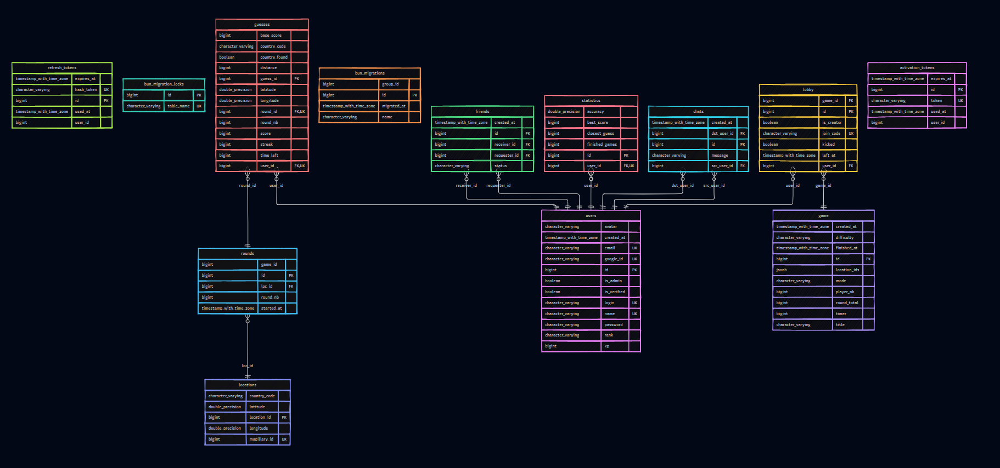

*This project has been created as part of the 42 curriculum by eelissal, ifounas, lserodon, spunyapr.*
# ATLAS Intelligence Network

## Description

**ATLAS Intelligence Network** is a web-based multiplayer geolocation game inspired by GeoGuessr, developed as part of the 42 `ft_transcendence` curriculum.

In this game players take on the role of intelligence agents tasked with locating the origin of a signal before it disappears. Using the visual clues provided by a street-level view, players must analyze their surroundings, identify the location, and make their guess before time runs out.

The application combines geolocation gameplay with social and real-time features, including user profiles, friends, chat, online-status tracking, multiplayer lobbies, game statistics, and leaderboards.

The application is built with **React, TypeScript, and Tailwind CSS** on the frontend, and **Go with Gin** on the backend. **PostgreSQL** is used for data persistence, with **Bun ORM** for database access. WebSockets power real-time features such as multiplayer lobbies, chat, and friend-status updates.

## Instructions & Requirements

### Prerequisites

Make sure you have the following installed:

- [Git](https://git-scm.com/)
- [Docker](https://www.docker.com/)
- [Docker Compose](https://docs.docker.com/compose/)
- `make`


### Setup & Installation

#### 1. Clone the repository

```bash
git clone <repository-url>
cd ft_transcendence
```

#### 2. Configure Environment Variables

Create your environment file from the example:

```bash
cp .env.exemple .env
```

Open `.env` and fill in the required values, such as database credentials, authentication secrets, and OAuth credentials if applicable.

For production, configure `docker-config/.env.prod` with the required production environment variables.

#### 3. Start the application

**Development mode**

Start the application using the base and development Docker Compose configurations:

```bash
make up
```

**Production mode**

Start the application using the production configuration:

```bash
make prod
```

### Useful Makefile Commands

#### Application Management

| Command | Description |
|---|---|
| `make up` | Start the application in development mode. |
| `make prod` | Update the production IP configuration and start the production containers. |
| `make down` | Stop and remove the development containers. |
| `make stop` | Stop the development containers without removing them. |
| `make restart` | Restart the development containers. |
| `make ps` | Display the status of the development containers. |
| `make re` | Remove containers, volumes, and images, then start the application again. |

#### Logs & Debugging

| Command | Description |
|---|---|
| `make logs-<service>` | Follow logs for a specific service. |
| `make in-<container>` | Open a shell inside a container. |
| `make print_posgres_ip` | Display IP address information from the PostgreSQL container. |

Examples:

```bash
make logs-golang
make logs-react
make in-golang
```

Replace the service or container name with the appropriate name from your Docker Compose configuration.

#### Database Migrations

ATLAS uses Bun ORM migrations to manage changes to the database schema.

| Command | Description |
|---|---|
| `make init_mig` | Initialize the migration system. |
| `make create_mig NAME=<name>` | Create a new migration file. |
| `make exec_mig` | Apply pending migrations. |
| `make rollback_mig` | Roll back the last migration. |
| `make status_mig` | Display migration status. |

Example:

```bash
make create_mig NAME=add_user_fields
make exec_mig
make status_mig
```

#### Cleanup

| Command | Description |
|---|---|
| `make fclean` | Remove development containers, volumes, and images. |
| `make clean-images` | Clean up unused Docker images after running `make clean`. |
| `make clean-caches` | Clean Docker images and Go/npm caches after running `make clean`. |

**Warning:** `make re`, `make fclean`, and the cleanup commands can delete data or cached dependencies. Use them carefully, especially if you need to preserve local database data.


### Access

#### Development

The website is available at http://localhost:5130/ 

Two additional tools are exposed in this environment: 
- **Adminer** at http://localhost:8082/ to inspect the database
- **Mailpit** at http://localhost:8025/ to catch the emails sent by the application.

#### Production (campus)

The website is available at https://campus.ocefunding.com:5130/

#### Production (remote server)

The website is available at https://ocefunding.com:5130/


## Resources

List of classic references related to the topic (documentation, articles, tutorials, etc.).

### Go & Gin
- [Go Documentation](https://go.dev/doc/): Go language documentation and standard library reference.
- [Gin Web Framework](https://gin-gonic.com/docs/): Routing, middleware, and request binding.
- [Effective Go](https://go.dev/doc/effective_go): Go coding conventions and best practices.
- [Go by Example](https://gobyexample.com/): Practical examples of goroutines, channels, closures, and other Go concepts.

### Frontend
- [React Documentation](https://react.dev/learn): Components, hooks, and context.
- [TypeScript Documentation](https://www.typescriptlang.org/docs/): TypeScript language reference.
- [Vite Documentation](https://vite.dev/guide/): Frontend development and build tooling.
- [Tailwind CSS Documentation](https://tailwindcss.com/docs): Utility-first styling and reusable UI patterns.

### Database & ORM
- [Bun Documentation](https://bun.uptrace.dev/): ORM models, relations, queries, and migrations.
- [PostgreSQL Documentation](https://www.postgresql.org/docs/current/): Database configuration, SQL, and data management.

### Authentication & Security
- [Go bcrypt Package](https://pkg.go.dev/golang.org/x/crypto/bcrypt): Password hashing.
- [RFC 7519: JSON Web Token (JWT)](https://datatracker.ietf.org/doc/html/rfc7519): JWT specification.
- [golang-jwt](https://pkg.go.dev/github.com/golang-jwt/jwt/v5): JWT implementation for Go.
- [MDN: Set-Cookie](https://developer.mozilla.org/en-US/docs/Web/HTTP/Reference/Headers/Set-Cookie): Cookie attributes and security.
- [MDN: SameSite Cookies](https://developer.mozilla.org/en-US/docs/Web/HTTP/Reference/Headers/Set-Cookie#samesitesamesite-value): Cookie behavior and cross-site request considerations.

### Validation
- [Zod Documentation](https://zod.dev/): Documentation for TypeScript schema validation, used to validate data on the frontend.
- [go-playground/validator](https://pkg.go.dev/github.com/go-playground/validator/v10): Go validation library documentation, used to validate backend request data and struct fields.

### OAuth 2.0 & Google Sign-In
- [RFC 9700: OAuth 2.0 Security Best Current Practice](https://datatracker.ietf.org/doc/html/draft-ietf-oauth-security-topics): OAuth security recommendations.
- [Google Identity: OAuth 2.0 for Web Server Applications](https://developers.google.com/identity/protocols/oauth2/web-server): Google's server-side OAuth flow.
- [Go OAuth 2.0 Package](https://pkg.go.dev/golang.org/x/oauth2): OAuth 2.0 support for Go.

### WebSockets
- [RFC 6455: The WebSocket Protocol](https://datatracker.ietf.org/doc/html/rfc6455): WebSocket protocol, including control frames.
- [Gorilla WebSocket](https://pkg.go.dev/github.com/gorilla/websocket): WebSocket implementation for Go.
- [Gorilla WebSocket Chat Example](https://github.com/gorilla/websocket/tree/main/examples/chat): Example of the hub and read/write pump architecture.
- [MDN: Writing WebSocket Client Applications](https://developer.mozilla.org/en-US/docs/Web/API/WebSockets_API/Writing_WebSocket_client_applications): WebSocket client communication.

### Mapping & Geolocation
- [Leaflet Documentation](https://leafletjs.com/reference.html): Reference for the interactive maps used for location guesses and game results.
- [MapillaryJS Documentation](https://mapillary.github.io/mapillary-js/docs): Documentation for the street-level imagery viewer used in the game.

### Infrastructure & Deployment
- [Docker Compose Documentation](https://docs.docker.com/reference/compose-file/): Multi-service application configuration.
- [Docker: Multi-Stage Builds](https://docs.docker.com/build/building/multi-stage/): Building optimized production images.
- [Nginx Documentation](https://nginx.org/en/docs/): Reverse proxy and web server configuration.
- [Scaleway Documentation](https://www.scaleway.com/en/docs/domains-and-dns/): Cloud infrastructure and DNS configuration.

### Design
- [Figma](https://help.figma.com/hc/en-us): Interface design, prototyping, and design references.

### AI Use

- **`eelissal`** - AI was used for research and rephrasing purposes: to retrieve simpler explanations of complicated subjects and to design plans to tackle new concepts or langages. It was also used for writing some functions briefs and some rephrasing of the documentation.

- **`ifounas`** - AI was used as a learning and debugging assistant to understand technical issues, explore unfamiliar concepts and libraries, review code for potential design and security problems, and assist with Docker configuration, shell scripts, and documentation. The main approach was to request explanations and official documentation rather than ready-made code. Project code was written independently, with a focus on understanding the implementation well enough to explain, debug, and maintain it.

- **`lserodon`** - AI was used as a development aid to understand new frameworks and languages, troubleshoot debugging issues, and explore ways to structure code. In some cases, it helped to provide guidance on code organization and implementation approaches but did not generate code. All code was written independently, with design decisions and project integration handled by the developer.

- **`spunyapr`** - AI was used as a learning tool to study unfamiliar programming languages and frameworks through practical exercises and guided lessons. It also helped simplify complex technical concepts and provided additional resources for further learning. As a design assistant, AI generated visual concepts based on the project's initial concept, which served as references for creating the original UI designs in Figma. AI also helped improve the wording and organize project documentation.

## Team Information

| Member | Role | Responsibilities |
|---|---|---|
| **eelissal** | Product Owner | Feature prioritization, Game logic, and Backend development |
| **spunyapr** | Project Manager | Project coordination, Frontend/Backend development, and Design system |
| **ifounas** | Backend / DevOps Tech Lead | Technical direction, Project setup, Backend development, and Production deployment |
| **lserodon** | Frontend Tech Lead | Frontend architecture/development, and Reusable components |

All team members contribute to development, testing, and code review.

## Project Management

### Tools

- **GitHub:** Version control, feature branches, pull requests, and code reviews.
- **Trello:** Task planning, assignment, and progress tracking.
- **Discord:** Team communication and coordination.
- **Google Sheets:** Bug tracking and issue follow-up.

### Workflow

Our team follows a collaborative workflow to organize development, monitor progress, and support each other throughout the project.

- **Task Distribution:** Tasks are assigned according to each member's role, responsibilities, and the project's priorities.
- **Weekly Meetings:** The team meets at least once a week to review each member's progress, discuss completed and ongoing tasks, and identify any difficulties or blockers. When someone encounters a problem, other members can provide support or help find a solution.
- **Weekly Task Updates:** At the beginning of each week, team members share their planned tasks in their dedicated Discord channels. These channels are also used to communicate progress, ask questions, and report difficulties throughout the week.
- **Git Workflow:** Development is organized using Git branches. Changes are submitted through pull requests and reviewed before being merged.
- **Testing and Bug Tracking:** Features are tested during development, and identified bugs are documented in Google Sheets to track their resolution.

## Technical Stack

### Frontend

<p align="left">
  
  
  
  
</p>

| Technology | Purpose | Why choose this? |
|---|---|---|
| **React** | Building the user interface and reusable components | Its component-based architecture makes development and maintenance easier. |
| **TypeScript** | Adding static typing to JavaScript | Helps catch errors early and improves maintainability. |
| **Tailwind CSS** | Styling the application and creating responsive layouts | Enables fast, consistent UI development with utility classes. |
| **Vite** | Frontend development server and build tool | Provides fast startup, hot module replacement, and efficient builds. |

### Backend

<p align="left">
  
  
  
</p>

| Technology | Purpose | Why choose this? |
|---|---|---|
| **Go** | Backend logic and API development | Offers strong performance and efficient concurrency. |
| **Gin** | HTTP routing and API handling | Provides lightweight routing and middleware support. |
| **Bun ORM** | Database access and query management | Simplifies database queries within the Go application. |
| **WebSockets** | Real-time communication | Enables instant updates for chat, lobbies, and online status. |

### Infrastructure & DevOps

<p align="left">
  
  
  
</p>

| Technology | Purpose | Why choose this? |
|---|---|---|
| **Docker Compose** | Running and coordinating application services | Simplifies multi-service setup and provides consistent environments. |
| **Nginx** | Web server and reverse proxy | Routes incoming requests to the appropriate services. |
| **GitHub** | Repository hosting and collaboration | Supports branches, pull requests, and code reviews. |

### Database

<p align="left">
  
</p>

| Technology | Purpose | Why choose this? |
|---|---|---|
| **PostgreSQL** | Storing accounts, friendships, games, and statistics | Provides reliable relational storage, transactions, and data integrity. |

### Design

<p align="left">
  
</p>

| Technology | Purpose | Why choose this? |
|---|---|---|
| **Figma** | Designing interfaces and prototypes | Helps the team plan layouts and maintain a consistent visual design. |

## Database Schema

ATLAS uses **PostgreSQL** for persistent storage and **Bun ORM** to map Go models to database tables. The database supports user management, multiplayer gameplay, geographical guesses, player progression, social interactions, and authentication.

### Tables and Relationships

The tables below are organized by functional priority, starting with the core game flow and user data.

### 1. Users

The `users` table stores player accounts, profile information, authentication-related data, and progression.

| Field | Type | Constraints / Default | Description |
|---|---|---|---|
| `id` | `BIGINT` | Primary key, auto-increment | Unique user identifier. |
| `login` | `VARCHAR` | Unique, nullable | User login. |
| `name` | `VARCHAR` | Unique, `NOT NULL` | Username. |
| `google_id` | `VARCHAR` | Unique, nullable | Google account identifier. |
| `password` | `VARCHAR` | Nullable | Stores the user's hashed password for authentication. |
| `email` | `VARCHAR`  | Unique, `NOT NULL` | User email address. |
| `is_verified` | `BOOLEAN` | `NOT NULL` | Whether the account is verified. |
| `avatar` | `VARCHAR` | Default: `'/avatars/avatar1.png'` | Avatar path. |
| `xp` | `BIGINT` | `NOT NULL`, default: `0` | Player experience points. |
| `rank` | `VARCHAR` | `NOT NULL`, default: `'Junior Agent'` | Player rank. |
| `is_admin` | `BOOLEAN` | `NOT NULL`, default: `false` | Indicates administrator privileges. |
| `created_at` | `TIMESTAMP` | Default: `CURRENT_TIMESTAMP` | Account creation time. |

**Relationships:** A user has one associated statistics record and can have multiple lobby records, according to the model declarations.

### 2. Game

The `game` table stores game configuration and session information.

| Field | Type | Constraints / Default | Description |
|---|---|---|---|
| `id` | `BIGINT` | Primary key, auto-increment | Unique game identifier. |
| `title` | `VARCHAR` | Nullable | Game title. |
| `mode` | `VARCHAR` | Nullable | Game mode. |
| `difficulty` | `VARCHAR` | Nullable | Game difficulty. |
| `timer` | `BIGINT` | `NOT NULL` | Timer configuration. |
| `round_total` | `BIGINT` | `NOT NULL` | Number of rounds in the game. |
| `finished_at` | `TIMESTAMP` | Nullable | Time the game finished. |
| `player_nb` | `BIGINT` | `NOT NULL`, check: `player_nb <> 0` | Configured player count; zero is prohibited. |
| `created_at` | `TIMESTAMP` | Default: `CURRENT_TIMESTAMP` | Game creation time. |
| `location_ids` | `JSONB` | Nullable | Stores location IDs as JSON data. |

**Relationships:** A game has multiple lobby records. The `Round` model also declares a relationship to a game through `game_id`.

### 3. Lobby

The `lobby` table stores player participation in game lobbies.

| Field | Type | Constraints / Default | Description |
|---|---|---|---|
| `id` | `BIGINT` | Primary key, auto-increment | Unique lobby record identifier. |
| `user_id` | `BIGINT` | Nullable in the model | ID of the associated user. |
| `game_id` | `BIGINT` | Nullable in the model | ID of the associated game. |
| `join_code` | `VARCHAR` | Unique, nullable | Code used to join a lobby. |
| `is_creator` | `BOOLEAN` | No explicit default | Indicates whether the user created the lobby. |
| `left_at` | `TIMESTAMP` | Nullable | Time the user left the lobby. |
| `kicked` | `BOOLEAN` | `NOT NULL`, default: `false` | Indicates whether the player was kicked and cannot rejoin the game. |

**Relationships:** The model declares a relationship between `lobby.game_id` and `game.id`. The `User` model also declares a relationship using `user_id`.

### 4. Rounds

The `rounds` table stores individual rounds within a game.

| Field | Type | Constraints / Default | Description |
|---|---|---|---|
| `id` | `BIGINT` | Primary key, auto-increment | Unique round identifier. |
| `round_nb` | `BIGINT` | `NOT NULL` | Round number. |
| `game_id` | `BIGINT` | `NOT NULL` | Associated game ID. |
| `loc_id` | `BIGINT` | `NOT NULL` | ID of the location used for the round. |
| `started_at` | `TIMESTAMP` | `NOT NULL` | Round start time. |

**Relationships:** Each round belongs to a game and a location, according to the model declarations.

### 5. Guesses

The `guesses` table stores player guesses and their results for individual rounds.

| Field | Type | Constraints / Default | Description |
|---|---|---|---|
| `guess_id` | `BIGINT` | Primary key, auto-increment | Unique guess identifier. |
| `latitude` | `DOUBLE PRECISION` | Nullable | Latitude submitted by the player. |
| `longitude` | `DOUBLE PRECISION` | Nullable | Longitude submitted by the player. |
| `country_code` | `VARCHAR(2)` | Nullable | Country code associated with the result. |
| `distance` | `BIGINT` | Nullable | Distance between the guess and target. |
| `country_found` | `BOOLEAN` | Default: `false` | Indicates whether the country was found. |
| `time_left` | `BIGINT` | Default: `0` | Remaining time. |
| `streak` | `BIGINT` | Default: `0` | Current streak value. |
| `base_score` | `BIGINT` | `NOT NULL` | Score before multipliers. |
| `score` | `BIGINT` | `NOT NULL` | Final score after multipliers. |
| `round_nb` | `BIGINT` | `NOT NULL` | Round number. |
| `round_id` | `BIGINT` | `NOT NULL`, composite unique index | Associated round ID. |
| `user_id` | `BIGINT` | `NOT NULL`, composite unique index | User who made the guess. |

**Constraints and relationships:** `round_id` and `user_id` share the composite unique index `idx_guess_user_round`, preventing duplicate guess records for the same user and round. Each guess belongs to a user and a round in the model declarations.

### 6. Locations

The `locations` table stores geographical data used in gameplay.

| Field | Type | Constraints / Default | Description |
|---|---|---|---|
| `location_id` | `BIGINT` | Primary key, auto-increment | Unique location identifier. |
| `mapillary_id` | `BIGINT` | Unique, `NOT NULL` | Mapillary identifier for the location. |
| `latitude` | `DOUBLE PRECISION` | `NOT NULL` | Location latitude. |
| `longitude` | `DOUBLE PRECISION` | `NOT NULL` | Location longitude. |
| `country_code` | `VARCHAR(2)` | `NOT NULL` | Two-character country code. |

### 7. Statistics

The `statistics` table stores player performance metrics.

| Field | Type | Constraints / Default | Description |
|---|---|---|---|
| `id` | `BIGINT` | Primary key, auto-increment | Unique statistics record identifier. |
| `user_id` | `BIGINT` | `NOT NULL`, unique | Associated user ID. |
| `finished_games` | `BIGINT` | `NOT NULL`, default: `0` | Number of finished games. |
| `accuracy` | `DOUBLE PRECISION` | `NOT NULL`, default: `0` | Player accuracy metric. |
| `best_score` | `BIGINT` | `NOT NULL`, default: `0` | Best recorded score. |
| `closest_guess` | `BIGINT` | Nullable | Closest recorded guess value. |

**Relationships:** The unique `user_id` and the model's `has-one` declaration represent one statistics record per user.

### 8. Friends

The `friends` table stores friendship requests between users.

| Field | Type | Constraints / Default | Description |
|---|---|---|---|
| `id` | `BIGINT` | Primary key, auto-increment | Unique friendship record identifier. |
| `requester_id` | `BIGINT` | `NOT NULL` | User who sent the request. |
| `receiver_id` | `BIGINT` | `NOT NULL` | User receiving the request. |
| `status` | `VARCHAR` | `NOT NULL`, default: `'pending'` | Friendship request status. |
| `created_at` | `TIMESTAMP` | Default: `CURRENT_TIMESTAMP` | Record creation time. |

### 9. Chats

The `chats` table stores messages exchanged between users.

| Field | Type | Constraints / Default | Description |
|---|---|---|---|
| `id` | `BIGINT` | Primary key, auto-increment | Unique message identifier. |
| `src_user_id` | `BIGINT` | `NOT NULL` | Sender's user ID. |
| `dst_user_id` | `BIGINT` | `NOT NULL` | Recipient's user ID. |
| `message` | `VARCHAR` | `NOT NULL` | Message content. |
| `created_at` | `TIMESTAMP` | Default: `CURRENT_TIMESTAMP` | Message creation time. |

### 10. Activation Tokens

The `activation_tokens` table stores tokens used for account activation.

| Field | Type | Constraints / Default | Description |
|---|---|---|---|
| `id` | `BIGINT` | Primary key, auto-increment | Unique token record identifier. |
| `user_id` | `BIGINT` | `NOT NULL` | Associated user ID. |
| `token` | `VARCHAR` | `NOT NULL`, unique | Activation token. |
| `expires_at` | `TIMESTAMP` | `NOT NULL` | Token expiration time. |
| `used_at` | `TIMESTAMP` | Nullable | Time the token was used. |

**Relationships:** The model declares a relationship to `users` through `user_id`.

### 11. Refresh Tokens

The `refresh_tokens` table stores hashed tokens used to refresh authentication sessions.

| Field | Type | Constraints / Default | Description |
|---|---|---|---|
| `id` | `BIGINT` | Primary key, auto-increment | Unique token record identifier. |
| `hash_token` | `VARCHAR` | `NOT NULL`, unique | Hashed refresh token. |
| `user_id` | `BIGINT` | `NOT NULL` | Associated user ID. |
| `expires_at` | `TIMESTAMP` | `NOT NULL` | Token expiration time. |
| `used_at` | `TIMESTAMP` | Nullable | Time the token was used. |

**Relationships:** The model declares a relationship to `users` through `user_id`.

### 12. Migration Tables

Bun uses these tables to manage database schema changes.

| Table | Description |
|---|---|
| `bun_migrations` | Records migrations that have been applied. |
| `bun_migration_locks` | Supports locking during migration operations. |

### Relationships Overview

<p align="center">
  <a href="docs/database-schema.pdf">
    
  </a>
</p>

<p align="center">
  <a href="docs/database-schema.pdf" target="_blank">
    View full database schema (PDF)
  </a>
</p>

## Features List

| Feature | Description | Contributors |
|---|---|---|
| User Authentication | User registration, login, account verification, and authentication management. | ifounas, spunyapr |
| Google OAuth | Authentication through Google accounts. | ifounas, spunyapr |
| User Profiles | User profile information, avatars, and profile management. |  eelissal, ifounas, lserodon , spunyapr |
| Friends System | Send, receive, and manage friend requests. | spunyapr |
| Friend Status | Display friends' online/offline status and availability in real time. | ifounas, spunyapr |
| Real-Time Chat | Exchange messages with other users. | eelissal, ifounas, spunyapr |
| Game Lobby | Create and join game lobbies using a join code. | eelissal, ifounas, lserodon |
| Geolocation Gameplay | Identify locations using geographical clues and submit guesses. | eelissal, lserodon |
| Solo Game | Play individually, explore locations, submit guesses, and earn scores without competing against other players. | eelissal, lserodon |
| Multiplayer Games | Play game sessions with other players. | eelissal, ifounas, lserodon |
| Round & Scoring System | Manage game rounds, calculate guess distances, and assign scores. | eelissal, lserodon |
| Player Statistics | Track completed games, accuracy, best score, and closest guess. | eelissal, spunyapr |
| XP & Ranking | Award experience points and track player progression. | eelissal, spunyapr |
| Leaderboard | Compare player scores and rankings. | eelissal, lserodon |
| Admin Permissions | Manage administrative privileges and protected actions. | eelissal, spunyapr |
| Responsive Design | Build application pages and reusable components for a consistent user experience across different screen sizes. | lserodon, spunyapr |
| Design & User Experience | Create design references and maintain a consistent interface. | lserodon, spunyapr |
| Database Layer | Initialized and configured Bun ORM with PostgreSQL, implementing database models and relationships for application entities. | ifounas |
| Infrastructure & Deployment | Configured the Docker multi-service architecture for PostgreSQL, Nginx, the Go backend, and React frontend; implemented multi-stage production builds and healthcheck-based startup ordering; configured the domain and DNS on Scaleway for ocefunding.com. | ifounas |

## Modules

### 1. Frontend and Backend Frameworks

**Major · 2 Points**

**Justification:**

Using frameworks for both the frontend and backend provides a structured, maintainable architecture and simplifies the development of a full-stack web application.

**Implementation:**

The frontend is built with React and TypeScript, bundled with Vite and styled using Tailwind CSS. React components and pages are connected to the backend API to provide an interactive user experience.

The backend uses Go and the Gin framework to handle HTTP requests and application logic. Its architecture includes models, repositories, handlers, routes, and authentication middleware to manage database operations, API endpoints, and access to protected resources.

**Contributors:**

- **`lserodon`**: Developed React pages and reusable components and integrated the frontend with the backend API.
- **`spunyapr`**: Developed React pages and reusable components, integrated the frontend with the backend API, and developed handlers for the friends system.
- **`ifounas`**: Set up the Gin server and route structure, implemented authentication middleware, and developed handlers for authentication, users, and lobbies.
- **`eelissal`**: Implemented and modified Go models, repositories, handlers, and routes for locations, guesses, rounds, games, and statistics.

### 2. Real-Time Features

**Major · 2 Points**

**Justification:** 

Real-time communication allows users to interact and receive updates without repeatedly refreshing the application. It is essential for keeping multiplayer lobbies synchronized, enabling live chat, and displaying up-to-date friend statuses.

**Implementation:** 

WebSockets are implemented to support real-time communication between the server and connected clients across three main features:

- **Game Lobby:** Support real-time communication for lobby interactions and updates.
- **Real-Time Chat:** Allow users to send and receive messages without refreshing the page.
- **Friend Status:** Provide real-time updates on friends' online/offline status.

This integration improves responsiveness and provides a more interactive experience across the application.

**Contributors:**

- **`ifounas`**: Implemented the backend WebSocket architecture for chat and lobby, including connection management, client registration, event handling, and real-time friend presence updates.
- **`eelissal`**: Implemented the backend WebSocket handlers for lobby actions.
- **`spunyapr`**: Implemented the frontend WebSocket integration for chat and friend status using a custom React hook and shared context to manage messages, friend presence, and real-time updates.
- **`lserodon`**: Implemented the frontend WebSocket client for the game lobby, handling lobby updates, game and round events, player actions, and connection cleanup.

### 3. User Interaction

**Major · 2 Points**

**Justification:** 

Social interaction makes the application more engaging by allowing users to communicate, view each other's profiles, build connections, and see which friends are currently online.

**Implementation:**

The application implements the core components required for user interaction:

- **Chat System:** Users can send and receive messages through a chat interface. The backend manages chat data, while WebSockets enable real-time message exchange.
- **User Profiles:** Users can view thier profile information.
- **Friends System:** Users can send and manage friend requests, add or remove friends, and access their friends list.
- **Friend Status:** Users can see their friends' online/offline status with WebSockets providing real-time status updates.

**Contributors:**

- **`ifounas`**: Implemented the user database model, chat WebSocket backend, and presence mechanism to broadcast online/offline status to friends through persistent WebSocket connections.
- **`spunyapr`**: Developed the chat and profile interfaces, implemented the friends system (frontend and backend), and integrated WebSockets into the frontend for real-time chat and friend status updates.
- **`eelissal`**: Implemented repository functions to delete chat messages, friend records, and user profile data when an administrator deletes a user account.

### 4. Use an ORM for the Database

**Minor · 1 Point**

**Justification:** 

An Object-Relational Mapping (ORM) simplifies database interactions by mapping database tables to application models. It reduces repetitive SQL code and makes database operations easier to maintain.

**Implementation:** 

Bun ORM is used in the Go backend to interact with the PostgreSQL database. Database models represent entities such as users, games, lobbies, rounds, guesses, locations, and statistics. Bun ORM handles database queries and CRUD operations between the application and the database.

**Contributors:**

- **`ifounas`**: Initialized Bun ORM and its PostgreSQL driver, defined database models and their relationships, and implemented the repository layer used by handlers. Worked on the users, activation_tokens, refresh_tokens, lobby, and game tables.
- **`eelissal`**: Implemented game-related database models and repository functions for the locations, rounds, statistics, and guesses tables.
- **`spunyapr`**: Implemented the friends database model and related repository functions for the friends and chats table.

### 5. Custom-Made Design System with Reusable Components

**Minor · Points: confirm from subject**

**Justification:**

A custom design system ensures a consistent visual identity across the application. Reusable components improve maintainability, reduce duplicated code, and provide a cohesive user experience.

**Implementation:**

The process began by establishing the project's visual guidelines, including the color palette, typography, and icons, followed by designing the user interfaces in Figma. Reusable UI elements were selected to be shared across different pages.

Development tasks were then divided to create reusable React components using React and Tailwind CSS. Once these components were ready, they served as building blocks for page development. This component-first approach ensured consistent styling across the application and reduced code duplication.

The module requires at least **10 reusable components**.

**Contributors:**
- **`lserodon`**: Developed reusable components such as `PrimaryButton`, `SecondaryButton`, `Podium`, `ChatBox`, and `Avatar`. Responsible for the Leaderboard, Game, Lobby, and Result pages.
- **`spunyapr`**: Developed reusable components such as `AuthenticationCard`, `Navbar`, `StatCard`, `FriendChatRow`, and `OperationHistoryRow`. Responsible for the Landing, Authentication, Home, and Profile pages.

### 6. Standard User Management and Authentication

**Major · 2 Points**

**Justification:** 

User management allows users to maintain their personal information, customize their profiles, and connect with other players. It provides a personalized experience and supports social interaction within the application.

**Implementation:**

- **Profile Management:** Users can view and update their profile information.
- **Avatar Management:** Users can upload a custom avatar, with a default avatar provided when none is uploaded.
- **Friends System:** Users can add and manage friends and view their online status.
- **Profile Page:** Each user has a profile page displaying their information.
- **Input Validation:** Validates email, usernames, login, and passwords during user registration, checks usernames when users update their profiles, and validates user information when administrators modify accounts.

**Contributors:**

- **`ifounas`**: Implemented email/password authentication, bcrypt password hashing, server-side input validation, JWT access and refresh token management, token rotation and reuse detection, secure cookie handling, and the user database model. Also implemented the backend WebSocket mechanism for real-time friend status.
- **`spunyapr`**: Developed the profile interface and profile update functionality, implemented the friends system (frontend and backend), developed the AuthContext to manage authentication state and refresh-token handling on the frontend, and implemented input validation using Zod on the frontend and Go's validator library on the backend.
- **`lserodon`**: Implemented the avatar upload backend, including the API route for receiving uploaded images, storing them, and making them available for display in the application.

### 7. Game Statistics and Match History

**Minor · 1 Points**

**Justification:**

Game statistics help players track their performance and progression, while the leaderboard allows them to compare their results with other players.

**Implementation:**

A statistics table was created in the database to store player statistics. Backend routes, handlers, and repository functions were implemented to manage and retrieve statistical data. The frontend displays player statistics and leaderboard information.

**Contributors:**

- **`eelissal`**: Implemented the statistics database table, backend routes, actions, handlers, and repository functions.
- **`lserodon`**: Developed the leaderboard frontend and integrated it with the backend API.
- **`spunyapr`**: Developed the statistics frontend and integrated it with the backend API.

### 8. OAuth 2.0 Authentication — Google

**Minor · 1 Points**

**Justification:**

Google OAuth 2.0 allows users to sign in with an existing Google account without creating a separate password. It also provides access to the user's email address, which is verified by Google when the provider confirms it.

**Implementation:**

The full server-side authorization code flow is implemented. A random `state` value is generated and stored in a short-lived cookie, then compared during the callback using a constant-time comparison to prevent CSRF attacks. The authorization code is exchanged for a token, and the Google user information endpoint is queried.

Account resolution follows three steps: lookup by Google ID, lookup by email (linking the Google ID to an existing local account), or creation of a new account. Username collisions are resolved by appending a random suffix, and accounts with unverified Google email addresses are rejected. Finally, the flow issues the same JWT token pair as a standard login.

**Contributors:**

- **`ifounas`**: Implemented the Google OAuth 2.0 authorization flow, account resolution and linking, user creation, and JWT issuance.
- **`spunyapr`**: Integrated Google OAuth login with the frontend.

### 8. Complete Web-Based Game

**Major · 2 Points**

**Justification:**

A complete web-based game provides an interactive experience with clear rules, gameplay mechanics, and scoring. It allows players to test their geographical knowledge by identifying real-world locations and competing with other players.

**Implementation:**

The game uses Mapillary for street-level imagery and Leaflet for the interactive map where players place their guesses. Players explore the location, submit a guess before the countdown ends, and receive results after each round. The scoring system evaluates guesses based on the distance from the correct location. At the end of the game, a final summary presents the results.

The application also includes a lobby where players gather before starting a multiplayer session and a leaderboard for comparing player rankings.

**Contributors:**

- **`eelissal`**: Developed the game logic using Mapillary and Leaflet integrations, and implemented the scoring system and gameplay rules.
- **`lserodon`**: Developed the gameplay interface, including street-level imagery, the interactive guessing map, countdown timer, round results, final game summary, lobby, and leaderboard.

### 9. Remote Players

**Major · 2 Points**

**Justification:**

Remote-player functionality allows users on separate computers to participate in the same game in real time. It requires synchronized game states, connection management, and recovery when players temporarily leave or lose their connection.

**Implementation:**

WebSockets enable real-time communication between players and the server. The lobby WebSocket manages communication for shared game sessions, while the frontend maintains synchronized game states, including game start, rounds, countdowns, and results.

The system also supports returning to an ongoing game when a player comes back to the application. Backend logic handles player reconnection and kicked-player actions before, during, and after a game. Goroutines are used to handle concurrent operations and support responsive multiplayer gameplay.

**Contributors:**

- **`ifounas`**: Implemented the backend WebSocket infrastructure for the game lobby, establishing the communication layer for multiplayer sessions.
- **`eelissal`**: Implemented the backend functions handling lobby WebSocket actions, including player reconnection and kicked-player actions before, during, and after a game. Used goroutines to support concurrent operations.
- **`lserodon`**: Developed the frontend WebSocket integration, including connection management, game-state synchronization, and returning players to an ongoing games.

### 10. Multiplayer Game (More Than Two Players)

**Major · 2 Points**

**Justification:**

Supporting more than two players in a single game requires coordinated gameplay, consistent timing, and clear result tracking to ensure that all participants can compete in the same session.

**Implementation:**

The application supports multiplayer games with three or more players. The lobby displays a live list of players in the session, and the host can start the game or kick players. Once the game begins, rounds progress automatically for all participants. After each round, a results page ranks the players based on their scores. At the end of the game, a final results page displays the overall rankings. Game timing is synchronized across players to ensure that participants follow the same round schedule.

**Contributors:**

- **`lserodon`**: Developed the frontend multiplayer experience, including the live player list in the lobby, host controls for starting games and kicking players, automatic progression between rounds, and results pages ranking players after each round and at the end of the game.
- **`eelissal`**: Implemented time synchronization between players to maintain consistent timing during multiplayer sessions.

### 11.Gamification System

**Minor · 1 Point**

**Justification:**

A gamification system encourages user engagement by rewarding players for their performance and progress. Clear scoring rules, rankings, and visual feedback allow users to track their achievements and compare their results with other players.

**Implementation:**

The application implements a persistent gamification system that includes:

- **Scoring System:** Calculates scores based on gameplay performance.
- **XP and Ranking:** Awards experience points (XP) and calculates player ranks to represent progression.
- **Leaderboards:** Displays player rankings to compare performance.
- **Statistics and Progression:** Presents player statistics and progress bars to help users track their performance.
- **Tutorial:** Explains the game's rules and progression mechanics to help users understand how the system works.

**Contributors:**

- **`eelissal`**: Implemented the backend functions and rules for game scoring, XP calculation, and leaderboard data.
- **`lserodon`**: Developed the leaderboard frontend and integrated it with the backend API.
- **`spunyapr`**: Implemented rank calculation, developed the statistics interface and progress bars, and created a tutorial explaining the game rules.


### 12. Public REST API

**Major · 2 Points**

**Justification:**

The frontend and backend run as separate services and communicate over HTTP. A consistent REST API provides a clear interface between them, with structured routes, appropriate HTTP methods, and predictable responses. This also allows the backend to expose endpoints for different user roles.

**Implementation:**

The backend exposes HTTP API endpoints for interacting with application data and functionality. The API follows REST conventions, using resource-based route naming, appropriate HTTP methods (`GET`, `POST`, `PUT`, and `DELETE`), consistent JSON responses, and HTTP status codes.

The API includes routes accessible to regular users and administrators, with middleware, handlers, and repository functions managing requests and database operations. Cross-origin resource sharing (CORS) is configured to allow communication between the frontend and backend, including the necessary header exposure for authentication tokens.

**Contributors:**

- **`ifounas`**: Designed the REST API structure, including resource-based route naming, appropriate HTTP methods, consistent JSON responses, and status codes. Configured CORS, including the exposure of headers required for authentication tokens.
- **`eelissal`**: Implemented public HTTP routes using `GET`, `POST`, `PUT`, and `DELETE`, with middleware, handlers, and repository functions supporting operations for regular users and administrators.

### 13. Advanced Permissions System

**Major · 2 Points**

**Justification:**

Role-based permissions allow administrators to manage users and perform actions that are restricted for regular users.

**Implementation:**

The application provides administrative user management, including viewing, updating, and deleting user accounts, with access controlled by middleware.

**Contributors:**

- **`eelissal`**: Implemented admin middleware and user viewing and deletion functionality.
- **`spunyapr`**: Implemented the admin functionality for updating user information.

## Module Summary

| Type | Module | Points |
|---|---|:-:|
| Major | Frontend and Backend Frameworks | 2 |
| Major | Real-Time Features | 2 |
| Major | User Interaction | 2 |
| Minor | Use an ORM for the Database | 1 |
| Minor | Custom-Made Design System with Reusable Components | 1 |
| Major | Standard User Management and Authentication | 2 |
| Minor | Game Statistics and Match History | 1 |
| Minor | OAuth 2.0 Authentication (Google) | 1 |
| Major | Complete Web-Based Game | 2 |
| Major | Remote Players | 2 |
| Major | Multiplayer Game (More Than Two Players) | 2 |
| Minor | Gamification System | 1 |
| Major | Public REST API | 2 |
| Major | Advanced Permissions System | 2 |
| | **Total** | **23 points** |


## Individual Contributions

### Team Contributions Summary

### `eelissal`
- **Backend Development:** Implemented Go models, repositories, handlers, and routes for game features and statistics.
- **Game Logic:** Developed gameplay rules, rounds, guesses, location integration, and scoring.
- **Real-Time Multiplayer:** Implemented lobby WebSocket actions and player reconnection handling.
- **Multiplayer Synchronization:** Implemented kick handling and time synchronization between players.
- **Gamification:** Implemented backend scoring, XP, and leaderboard logic.
- **Administration:** Implemented admin middleware and user viewing and deletion functionality.

### `ifounas`
- **Backend Infrastructure:** Set up the Gin server, routing structure, authentication middleware, and Bun ORM with PostgreSQL.
- **Backend Development:** Implemented Go models, repositories, handlers, and routes for users, activation_tokens, refresh_tokens, lobby and game
- **Authentication & Security:** Implemented email/password authentication, JWT access and refresh tokens, token rotation, reuse detection, and secure cookies.
- **Google OAuth:** Implemented Google sign-in and account resolution.
- **Real-Time Communication:** Developed backend WebSocket infrastructure for the lobby, chat, and friend status.
- **Deployment:** Set up Docker Compose, Nginx, and Makefile commands.

### `lserodon`
- **Frontend Development:** Built reusable React components and pages for the game, lobby, leaderboard, and results.
- **Multiplayer Gameplay:** Implemented the live lobby player list, host controls, automatic round progression, and multiplayer rankings.
- **Real-Time Communication:** Integrated the frontend lobby WebSocket and game-state updates.
- **User Profiles:** Implemented the avatar upload API endpoint.
- **Gamification:** Developed the leaderboard interface and connected it to the backend API.
- **Design System:** Created reusable UI components using React and Tailwind CSS.

### `spunyapr`
- **Frontend Development:** Built reusable React components and pages for authentication, landing page, home page, and profiles.
- **Friends System:** Implemented friend management features and backend API routes.
- **Real-Time Communication:** Integrated frontend WebSockets for chat and friend status.
- **Authentication & User Management:** Implement profile updates, and the admin endpoint for updating user information.
- **Gamification:** Implemented rank calculation, statistics interfaces, progress bars, and the game tutorial.
- **Design System:** Created reusable UI components using React and Tailwind CSS.

### Technical Challenges and Solutions

**`eelissal`**: 

My main tasks and responsabilities were game feature prioritization, game logic and backend development. Firstly, the goal of feature prioritization was to choose which feature to create and implement first to provide a smoother tackling of both the modules and the game's development. Secondly, the objective regarding game logic was to define the rules for both solo and multiplayer modes, which were very similar to the base Geoguessr game, but with a few twists, followed by the scoring rules. I also tackled the 2D and 3D map loading on both the frontend and backend. Lastly, to implement this game and scoring logic, I created all the tables and functions for locations, guesses, rounds, and games (modifying the model and adding various CRUD functions with related repository functions linked to the timer and random locations for each game), as well as statistics tables. I also implemented admin routes and actions using middleware, handlers, and repository functions (for GET and DELETE). Since the tables are highly interconnected, I also had a significant impact on the user table and its functions (for actions related to XP and leaderboards). The main challenges I faced during this project were learning new languages (Go, TypeScript) and deepening my knowledge of technologies I had rarely used (SQL, HTML, CSS). I also had to adapt to new frameworks (Gin, React). Furthermore, working with such an interconnected database was a major challenge: the table relationships were complex (guesses, rounds, games, locations, statistics, and users were all linked to one another in the backend tasks I handled). As for the problems I faced, one was linked to our decision to use open-source data instead of paying for Google APIs. This decision introduced another problem: the quality of the data we could retrieve. On Mapillary, any user can upload their own street-view images, so the quality can be very poor. Many are simple photos rather than true 360° views, and finding a random, high-quality 360° image through a script was mostly a matter of luck (otherwise, it would mean very long loading times to find just one, or a much less random search). Additionally, most of the data retrieved was from European countries or the US, where coverage is much higher. Therefore, we decided to find a more balanced set of high-quality locations by ourselves and store them in a database table instead of making live APIs calls to get a random one. As a result, we now have locations that are much more geographically balanced and of significantly higher quality (recent 360° images). Furthermore, there is no longer a need to wait to retrieve and check each random game location—only a single database query is required.

**`ifounas`**:

1. Moving Tokens from Headers to Cookies

My first implementation returned both the access and refresh tokens in the response headers, leaving the frontend to store them. This was a weak design: tokens kept in JavaScript-accessible storage can be read by injected scripts, and nothing prevented a refresh token from being replayed indefinitely.

I rewrote the flow around cookies. Both tokens are now set as `HttpOnly` cookies, so the frontend never handles them directly and JavaScript cannot read them. The refresh token is additionally scoped to `/api/auth`, keeping it out of requests to other paths.

I then added token rotation, where each refresh consumes the current token and issues a new one, along with reuse detection. When a token whose `UsedAt` field is already set is presented again, every session belonging to that user is invalidated. A replayed token may indicate theft, so the safe response is to invalidate all sessions and require the user to log in again.

2. Handling Username Collisions During Google Sign-In

With email/password registration, users choose their own usernames, and a conflict can simply be rejected with an error. OAuth removes that possibility: the username comes from Google, the user has no say in it during the sign-in flow, and there is no form to display an error because the process relies on redirects.

As a result, account creation failed whenever a Google display name was already taken. I solved this in `resolveGoogleUser` by checking the username against the database and, if a conflict exists, appending a random suffix until an available name is found. The loop is bounded to avoid running indefinitely if a database error persists. This allows the user to obtain a working account immediately and rename it later if desired.

3. Understanding and Implementing the Ping/Pong Mechanism

A TCP connection that dies abruptly, for example because a tab is closed or a Wi-Fi connection drops, does not always notify the server. Without connection failure detection, the connection can remain in the clients map indefinitely, along with its goroutines, while other players continue seeing a user who is no longer connected.

The browser handles pong responses automatically, so implementing this mechanism on the server side was new to me. The mechanism relies on a loop between the two pumps: `WritePump` sends a ping every 54 seconds, the client automatically responds with a pong, and `SetPongHandler` extends the read deadline by another 60 seconds.

As long as pongs arrive, the deadline keeps being extended. When a pong is missing and the deadline expires, `ReadMessage` fails, `ReadPump` exits, and the deferred calls unregister the client and close the connection. The ping interval is deliberately shorter than the read deadline so that a healthy connection is not disconnected prematurely.

The part that took me the longest was understanding that control frames do not need to be filtered manually: Gorilla WebSocket handles them inside `ReadMessage` and returns only application messages. This also means that pongs are processed only while a read is in progress.

4. Connecting the Hub to the HTTP Handler

Upgrading an HTTP request to a WebSocket connection and connecting it to the hub was the hardest part of the project, taking me two days. `client_ws` is a generic package: it knows how to read from and write to a connection, but nothing about lobbies, hubs, or channels. The hub, on the other hand, manages the register, unregister, and action channels but has no access to the HTTP request.

I connected the two using closures. `JoinLobby` authenticates the user, checks that they belong to a lobby, upgrades the connection, and creates two functions that capture the context, hub, and client. These functions are passed to `ReadPump`, which calls them without needing to know their implementation: one sends the parsed action to the hub's action channel, while the other sends the client to the unregister channel.

This approach inverts the dependency: the lobby package injects its behavior into the WebSocket package. It also allows the same `client_ws` package to be reused for both the lobby and chat.

Two important details emerged after my initial implementation. First, `ReadPump` must block within the handler rather than run in a separate goroutine; otherwise, Gin cancels the request context while the connection is still active. Second, a handler that refuses a WebSocket upgrade must still send an HTTP response. Returning silently leaves the client waiting for the handshake to complete.


**`lserodon`**:

WebSockets: Real-time communication was the hardest part of the frontend. The WebSocket protocol evolved while the backend was being developed, and at one point two separate connections were opened for the same game. I solved this by centralizing all the WebSocket logic in a single shared context used by every page, then rewriting it from the documented protocol rather than patching it message by message.

Connecting the frontend to the backend: This was the first time I had connected a frontend to a backend, and I struggled at first to understand how to do it and where to find what I needed in the backend code. I started by building the pages with mock data so I could keep making progress, then learned to read the backend routes and WebSocket handlers, asked my teammates when the data formats were unclear, and tested each connection step by step with the real data.

**`spunyapr`**:

1. Learning New Languages and Technologies in a Short Time

One of my biggest challenges was learning new languages and technologies within a limited time while finding the confidence to start developing. At the beginning, I struggled to decide how much I needed to learn before writing code. I was afraid that starting too early, without enough knowledge, would lead me in the wrong direction and make the code difficult to fix later. On the other hand, I was also worried about spending too much time learning without making progress on the project.

To overcome this, I used AI to guide me through small lessons and practical examples, which helped me build a basic understanding of unfamiliar concepts and gain the confidence to start coding. Along the way, I realized that not every decision had to be perfect from the beginning. Sometimes, the best way to learn was to implement something, discover its limitations, and improve it later. Going back to modify an earlier implementation was not necessarily a problem, but a normal part of development.

2. Understanding How a Web Application Works

Before this project, I had never developed a complete web application. In the 42 Common Core, most projects focused on algorithms or backend development, whereas this project required both frontend and backend development and, more importantly, making them work together.

At first, I found it difficult to understand how the different parts of the application connected. I had questions about how the frontend communicated with the backend, how data was transferred, and how the different components worked together to provide a complete user experience.

Researching these concepts and getting explanations from my teammates helped me gradually understand the overall architecture. When a concept was particularly difficult to understand, I also used AI to explain it in simpler terms and provide examples. This helped me build a clearer picture of how the application worked as a whole, rather than seeing the frontend and backend as separate pieces of code.

3. Managing API Calls and Sharing Data Between Frontend Components

Another challenge was deciding how to manage API calls and share data between frontend components. Since `lserodon` and I both worked on the frontend, some information fetched from the backend, such as the username, avatar, and rank, was needed across different pages and components.

Initially, I needed to figure out how to avoid repeatedly fetching the same information and how to make it accessible wherever it was needed. This led me to explore React concepts such as Context and shared state management.

I created an `AuthFetch` context to handle authentication-related requests and fetch user information after authentication. This allowed the retrieved information to be shared across components instead of having each component manage the same data independently. Through this process, I learned more about React Context, organizing API calls, and managing shared data in a frontend application.

This challenge taught me that frontend development involves more than building interfaces. It also requires careful decisions about data flow, state management, and how components communicate with each other.