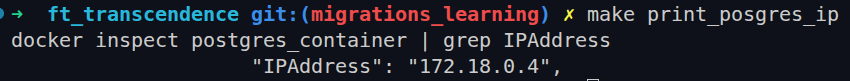
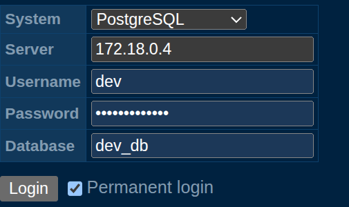

# installation : 

You have to put the .env file inside docker-config/
Then you can make up
```
make up
```
If you want to see all the logs you can 
```
make logs
```
Or (frontend only)
``` 
make logs-react
```
Or (backend only)
``` 
make logs-golang
```

Now you can acces the website / api from : 
```
http://localhost:5130/
```
Or 
```
http://localhost:5130/api/
```

## Database setup (follow it everytime you start your containers)
Follow these steps to properly initialize and access your database:

1. **Start the containers**  
   Make sure all Docker containers are up and running without any errors.

2. **Initialize the migrations** (only once)  
   Run the following command to generate the migration files:
   ```
   make init_mig
   ```
3. **Apply the migration** (only once / when you created a new migration)  
    then you can exec the migrations to fill the database
    ```
    make exec_mig
    ```

4. **Access the database UI**
    
    Find the PostgreSQL container IP addr:
    ```
    make print_postgres_ip
    ```
    Copy the IP address displayed in your terminal.:
    

    Open your browser and go to:
    ```
    http://localhost:8082/
    ```

    Put the IP addr in the Server field.

    Fill in the Username, Password, and Database fields using the credentials
    

